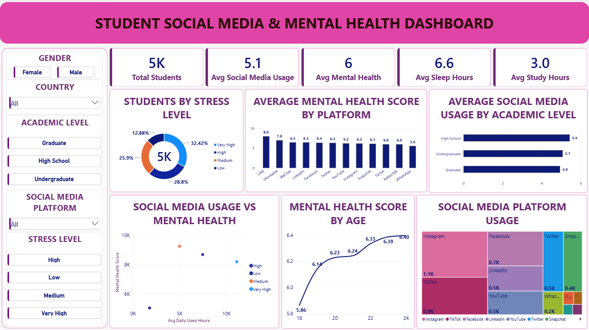

# Student Social Media & Mental Health Dashboard 📊

An interactive **Power BI dashboard** designed to explore student social media usage, stress levels, sleep patterns, study hours, and mental health indicators. This project transforms student-related data into meaningful visual insights through interactive filters, KPI cards, and data visualizations.

## 📸 Dashboard Preview



## 📌 Project Overview

Social media has become an important part of students' daily lives. Understanding how social media usage relates to students' mental health, stress levels, sleep duration, and study habits can help identify patterns within student data.

This project uses **Microsoft Power BI** to build an interactive dashboard that provides an overview of student behavior and mental-health-related indicators. Users can explore the data by gender, country, academic level, social media platform, and stress level.

The dashboard focuses on presenting data in a clear, visually appealing, and easy-to-understand format to support exploratory data analysis and data-driven insights.

## 🎯 Project Objectives

- Analyze student social media usage across different academic levels.
- Explore mental health scores across various social media platforms.
- Understand the distribution of students by stress level.
- Examine mental health score patterns across age groups.
- Compare social media usage with mental health indicators.
- Present key performance indicators through an interactive dashboard.
- Enable users to explore student data using interactive slicers and filters.

## 📊 Key Performance Indicators (KPIs)

The dashboard highlights the following key metrics:

| KPI | Value |
|---|---:|
| Total Students | 5K |
| Average Social Media Usage | 5.1 hours|
| Average Mental Health Score | 6.0 hours|
| Average Sleep Hours | 6.6 hours|
| Average Study Hours | 3.0 hours|

## 📈 Dashboard Visualizations

### 1. Students by Stress Level
Displays the distribution of students across Very High, High, Medium, and Low stress categories.

### 2. Average Mental Health Score by Platform
Compares average mental health scores across social media platforms to identify differences in the displayed scores.

### 3. Average Social Media Usage by Academic Level
Compares social media usage among High School, Undergraduate, and Graduate students.

### 4. Social Media Usage vs. Mental Health
Uses a scatter plot to explore the relationship between social media usage and mental health indicators.

### 5. Mental Health Score by Age
Visualizes how the average mental health score varies across different ages.

### 6. Social Media Platform Usage
Uses a treemap to compare the distribution of usage across social media platforms.

## 🎛️ Interactive Filters

The dashboard includes interactive slicers that allow users to filter and explore the data by:

- **Gender:** Female and Male
- **Country:** Explore records by country
- **Academic Level:** High School, Undergraduate, and Graduate
- **Social Media Platform:** Filter by the available platforms
- **Stress Level:** High, Low, Medium, and Very High

These filters make it easier to compare different student groups and examine specific patterns in the dataset.

## 🛠️ Tools & Technologies

- **Microsoft Power BI** — Dashboard development and data visualization
- **Power Query** — Data cleaning and transformation
- **DAX** — Measures and KPI calculations
- **Data Visualization** — KPI cards, bar charts, line charts, scatter plots, donut charts, and treemaps

## 💡 Key Analytical Areas

This dashboard supports exploration of the following questions:

- How is the student population distributed across stress levels?
- How does average social media usage differ by academic level?
- How do mental health scores vary across social media platforms?
- What patterns can be observed between social media usage and mental health indicators?
- How do mental health scores vary across age groups?
- Which platforms account for larger portions of the displayed usage distribution?

## 🚀 Skills Demonstrated

- Interactive dashboard design
- Data visualization and storytelling
- KPI presentation
- Comparative analysis
- Exploratory data analysis
- Slicer-based data exploration
- Business intelligence reporting
- Dashboard layout and visual formatting

## 📂 Repository Structure

```text
Student-Social-Media-Mental-Health-Dashboard/
│
├── README.md
├── Screenshot
└── Student_Social_Media_Mental_Health.pbix
```

## ▶️ How to Use This Project

1. Clone or download this repository.
2. Open `Screenshot` to view the dashboard preview.
3. Download the `.pbix` file.
4. Open the file using Microsoft Power BI Desktop.
5. Use the interactive slicers to explore different student groups and dashboard metrics.


## 👨‍💻 Project Purpose

This project is part of my learning journey in **Data Analytics and Data Science**. It demonstrates my interest in transforming raw data into interactive visualizations and communicating analytical findings through dashboards.

I aim to continue developing my skills in data analysis, business intelligence, and data storytelling through practical projects.

---

**If you find this project useful, feel free to ⭐ star the repository!**

#PowerBI #DataAnalytics #DataVisualization #Dashboard #BusinessIntelligence #DataScience

